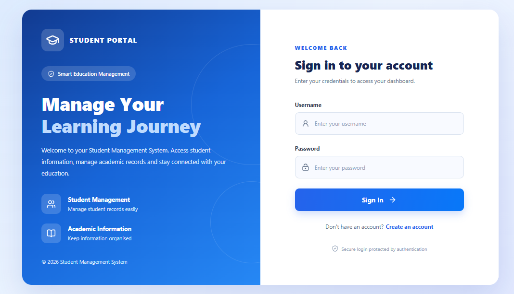
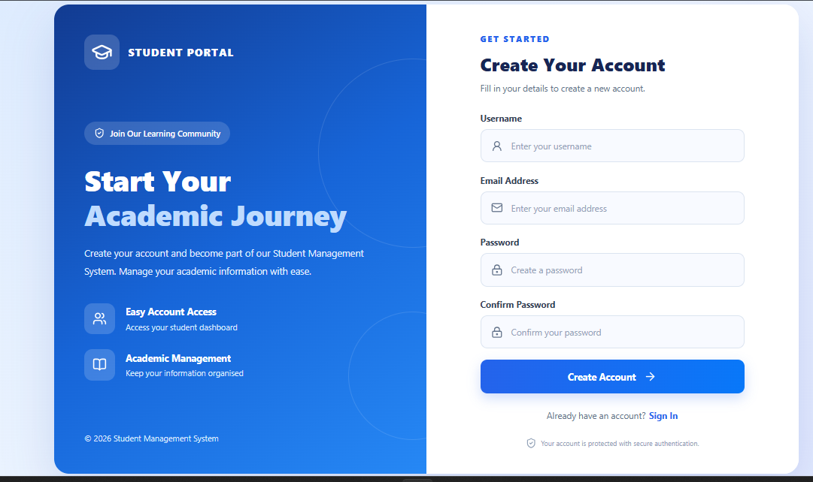
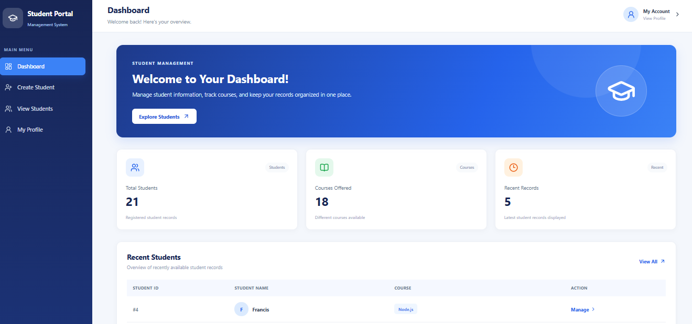
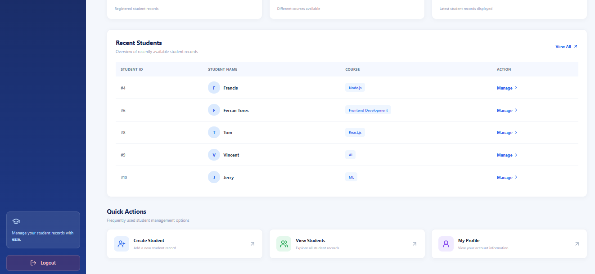
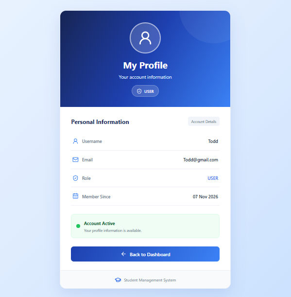
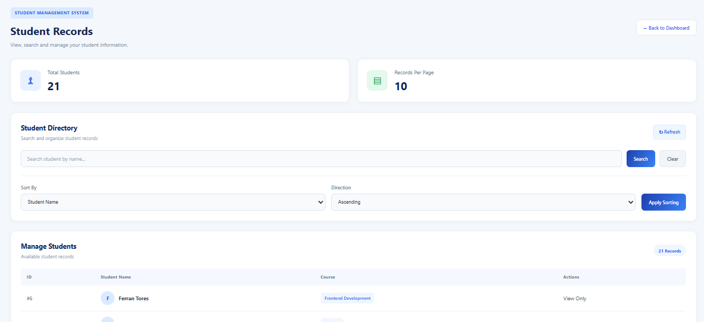
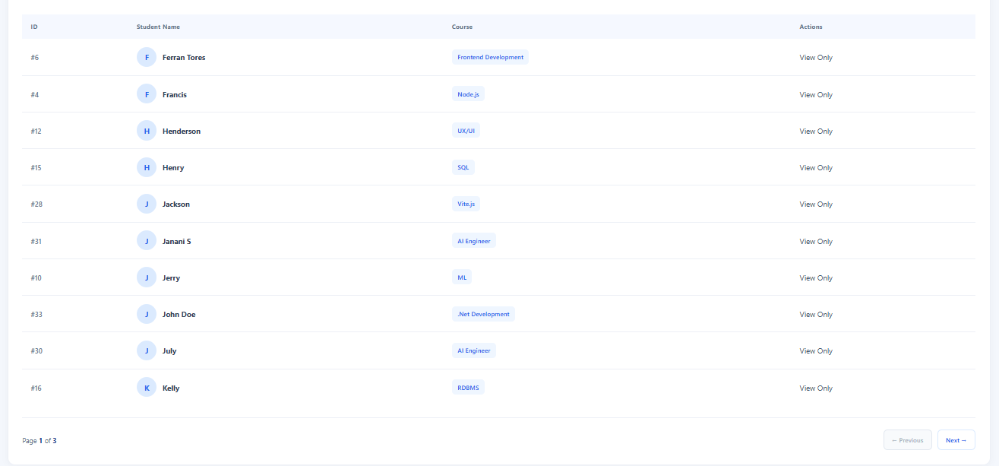
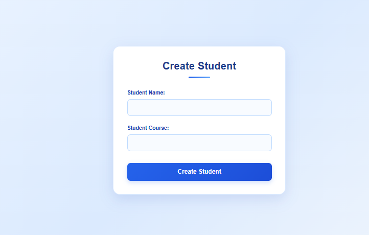
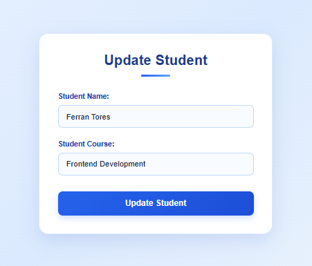

# Student Management System

A full-stack Student Management System developed using Spring Boot and React. This application provides student management operations, user authentication, role-based authorization, and profile management.

## Technologies Used

### Backend
- Java
- Spring Boot
- Spring Data JPA
- Spring Security
- JWT Authentication
- Hibernate

### Frontend
- React.js
- JavaScript
- HTML5
- CSS3
- Axios
- React Router

### Database
- MySQL

### API Documentation
- Swagger UI
- OpenAPI

### Testing
- JUnit 5
- Mockito

### Tools
- IntelliJ IDEA
- Visual Studio Code
- Postman
- Git and GitHub
- Maven

## Features

- User registration and login
- JWT-based authentication
- Role-based authorization (ADMIN and USER)
- Student creation, viewing, updating, and deletion
- Student search and management
- User profile management
- Protected frontend routes
- Secure logout
- RESTful API development
- API documentation using Swagger UI
- Backend unit testing using JUnit 5 and Mockito

## Project Structure

```text
student-management-system/
│
├── Backend/
│   ├── src/
│   ├── pom.xml
│   └── mvnw
│
├── frontend/
│   ├── public/
│   ├── src/
│   ├── package.json
│   └── package-lock.json
│
└── README.md
```

## Backend Setup

1. Open the Backend folder in IntelliJ IDEA.
2. Configure your MySQL database.
3. Set the required environment variables:
   - DB_USERNAME
   - DB_PASSWORD
   - JWT_SECRET
4. Run the Spring Boot application.

Backend URL:

```text
http://localhost:8082
```

## Frontend Setup

Open a terminal inside the frontend folder and execute:

```bash
npm install
npm start
```

The React application will run at:

```text
http://localhost:3000
```

## API Documentation

Swagger UI is available at:

```text
http://localhost:8082/swagger-ui/index.html
```

Use Swagger UI to explore and test the REST API endpoints.

## Testing

Backend unit tests are written using:

- JUnit 5
- Mockito

Run backend tests using:

```bash
mvn test
```

## Author

**Sujan Prashanth P S**

GitHub: [Sujanprashanth](https://github.com/Sujanprashanth)

## Application Screenshots

### 1. Login Page


### 2. Registration Page


### 3. Dashboard




### 4. User Profile


### 5. Student List




### 6. Create Student


### 7. Update Student


---

*Developed as a full-stack learning and practice project.*
